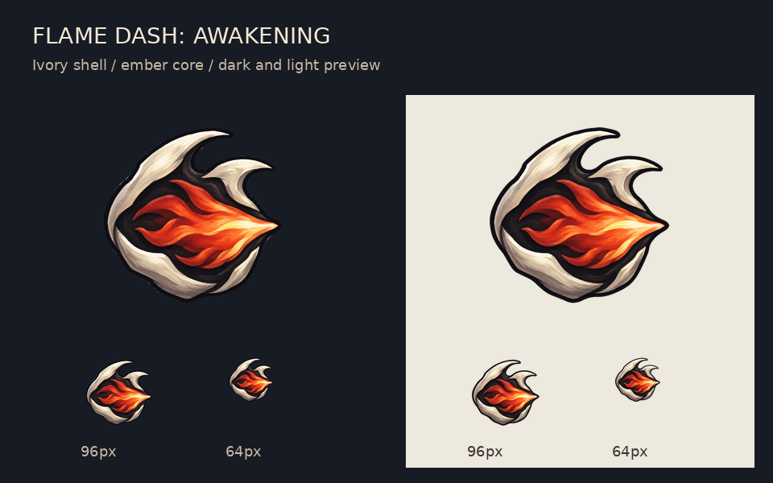

# 烈焰闪·觉醒护符图标

参考现有汲元火眼护符的象牙色外壳、深色轮廓与橙红配色，用向前掠出的火焰表现冲刺。


- [256 × 256 透明 PNG](icon.png)
- [1024 × 1024 透明 PNG](icon-1024.png)
- [深浅背景与小尺寸预览](preview.png)
- [生成原图](original.png)
- [完整提示词](prompt.txt)



使用用户配置的 `gpt-image-2.5-flare` API，以现有火眼护符为风格参考生成。
原图完整保留；透明图和尺寸变体通过复用 `tools/prepare_charm_icon.py` 的离线处理逻辑生成。
当前为独立图片方案，游戏内资源引用尚未切换。

在项目根目录重新生成透明图和预览：

```bash
.tools/python/bin/python output/imagegen/flame-dash-awakening-v1/prepare.py
```

各文件的 SHA-256 见 [manifest.json](manifest.json)。
